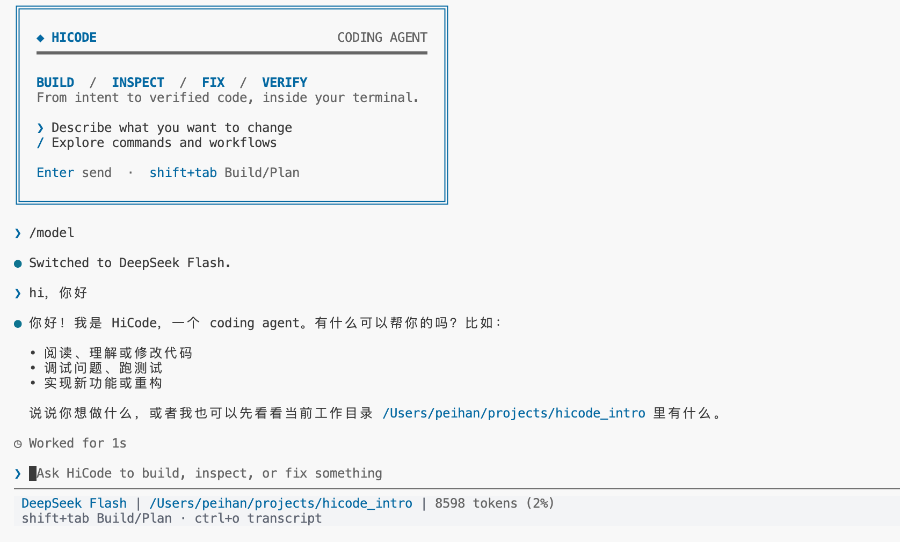
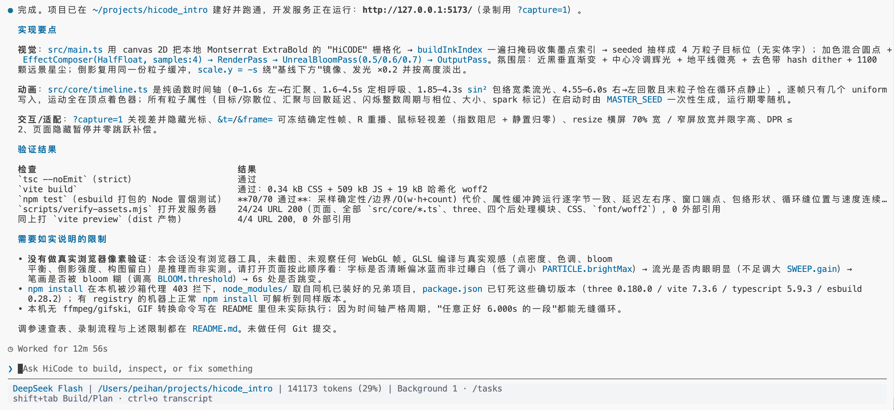

# HiCode

简体中文 | [English](README.en.md)

<p align="center">
  
  <br>
  <sub>一段 Prompt，由 HiCode × DeepSeek Flash 实现。</sub>
</p>

## 项目介绍

HiCode 是一个基于 TypeScript 自研的轻量级终端 Code Agent，核心源码不到 4 万行。用自然语言描述需求，即可让它编写代码、修复问题并运行测试。

支持 **macOS、Linux 和 Windows（通过 WSL2）**，在本机运行，接入你自己的模型 API Key 即可使用。

---

## 🚀 公开评测 · 关键进展

### ⭐ Terminal-Bench 2.1

于 2026 年 10 月 11 日完成评测。

1. HiCode：原题干通过 **83/89（93.3%）**；含两道题干补充后通过 **85/89（95.5%）**。使用 Qwen3.8-Flash + DeepSeek V4.1 Flash。
2. [DeepSeek V4.1 Flash 公开参考](https://huggingface.co/deepseek-ai/DeepSeek-V4.1-Flash#performance-across-agent-scaffolds-deepswe-v11-and-terminal-bench-21-max-reasoning-effort)：搭配 Codex、Claude Code、DeepSeek Harness Minimal 的通过率分别为 **84.1%、88.0%、90.6%**。每题独立评测 3 次，统计平均通过率。
3. 其他模型的公开参考：[GPT-5.6 Sol + Codex](https://huggingface.co/deepseek-ai/DeepSeek-V4.1-Flash#comparison-with-frontier-models-max-reasoning-effort) **88.8%**、[Kimi K3 + Kimi Code](https://www.kimi.com/en/blog/kimi-k3) **88.3%**、[GLM-5.3 + Claude Code](https://huggingface.co/zai-org/GLM-5.3) **88.2%**、[Qwen3.8-Max + Claude Code](https://huggingface.co/Qwen/Qwen3.8-2.4T-A95B-FP8) **86.6%**（每题评测 10 次取平均）。

题干说明：两道题的原题干未明确说明输出格式或行为要求，因此补充了说明，验收测试保持不变。

评测说明：为控制成本，HiCode 每题验收通过后即记为通过，不再重复测试；若独立重复评测，平均通过率预计会略有下降。


### ⭐ DeepSWE 1.1

DeepSWE 包含 113 道原创工程任务，覆盖 91 个开源仓库；官方参考解平均新增 **668 行代码、修改 7.4 个文件**，重点考察仓库探索与跨文件实现能力。[官方统计](https://arxiv.org/pdf/2607.07946#page=6)

🔥 持续评测中。

1. HiCode：截至 2026 年 10 月 21 日，累计通过 **95/113（84.1%）**，使用 Qwen3.8-Flash + GLM 5.3 Flash + DeepSeek V4.1 Flash。
2. [DeepSeek V4.1 Flash 公开参考](https://arxiv.org/html/2609.19969v1#S5.SS3.SSS4)：搭配 Codex、Claude Code、mini-SWE、DeepSeek Harness Minimal 的通过率分别为 **65.6%、69.8%、74.2%、72.6%**。推理强度为 max，每题独立评测 8 次，统计平均通过率。
3. 其他模型的公开参考：[Kimi K3 + Kimi Code](https://www.kimi.com/en/blog/kimi-k3) **67.5%**、[GLM-5.3 + mini-SWE-agent](https://huggingface.co/zai-org/GLM-5.3) **66.9%**、[GLM-5.3-Flash + mini-SWE-agent](https://huggingface.co/zai-org/GLM-5.3-Flash) **63.4%**、[Qwen3.8-Max + Claude Code](https://huggingface.co/Qwen/Qwen3.8-2.4T-A95B-FP8#benchmark-results) **56.6%**。

评测说明：从个人体感来看，DeepSWE 1.1 的难度显著高于 Terminal-Bench 2.1，平均输出 Token 消耗为其 **2.5 倍左右**。为控制成本，HiCode 每题验收通过后即记为通过，不再重复测试；若独立重复评测，平均通过率预计会有较明显的下降。


---

💰 **评测投入**：全部评测费用由项目作者个人承担。为控制开销，优先使用成本较低的模型，遇到未通过的难题后再使用 DeepSeek V4.1 Flash。

🎯 **评测目的**：通过真实任务暴露问题，持续改进 HiCode 的 harness；通过率主要作为观察 HiCode 效果的间接指标。

---

## 功能与界面

<table width="100%">
  <tr>
    <th width="43.3%">启动界面</th>
    <th width="56.7%">任务执行</th>
  </tr>
  <tr>
    <td width="43.3%" valign="top"></td>
    <td width="56.7%" valign="top"></td>
  </tr>
</table>

- **开发与维护**：从零搭建项目，或审查、修复和扩展已有代码。
- **长任务执行**：子 Agent 协作、上下文管理和项目记忆，支持执行中补充要求。
- **能力扩展**：支持 MCP、Skills、Hooks、图片输入（需模型支持）和 TypeScript SDK。

### 近期重点优化

- 💻 **10-21 · WSL2 支持**：支持在 Windows 的 WSL2 环境运行。

- 🛠️ **10-17 · 执行框架优化**：统一子 Agent 后台执行与结果通知，强化待办完成校验，优化后台复盘、请求异常恢复和工具结果展示，提升复杂任务的执行稳定性。

- 🧠 **10-11 · 模型与长任务执行**：支持推理强度调节与思考过程续传，优化后台复盘、网络获取和工具等待，提升复杂任务的执行稳定性。

- 🧱 **10-04 · 测试环境隔离**：共享 Linux 底座，按依赖版本复用镜像，每题独立容器运行，减少重复安装与环境干扰。

- 🛠️ **10-01 · Agent 执行链**：根据公开题评测反馈，统一后台任务的排队、状态与通知，支持长任务续接，并在取消或失败时完整收尾。

- 🐧 **09-26 · Linux 适配**：支持 Linux 环境运行，统一双端安装流程，完善沙箱隔离与终端展示。

- 🔌 **09-25 · MCP 机制优化**：简化配置与授权，完善工具加载、更新和连接管理，让外部工具顺畅参与 HiCode 执行。

- 🌐 **09-21 · 网络策略**：支持通过 `/sandbox` 切换开放或受限网络，在保留文件隔离的同时减少联网审批。

- 🔍 **09-20 · 工具与检索**：精简内置工具，统一通过 Bash 与 ripgrep 完成本地检索，减少重复实现，提升检索效率。

- 🤝 **09-19 · 子 Agent 协作**：完善主 Agent 的任务分派与子 Agent 派生，优化并行执行、双向沟通和上下文续跑。

## 快速开始

在 macOS 或 Linux 终端安装或更新；Windows 用户请在 WSL2 的 Linux 终端内执行：

```bash
curl -fsSL https://raw.githubusercontent.com/peihanm/hicode/main/install.sh -o hicode-install.sh && bash hicode-install.sh
```

脚本自动识别系统，下载所需依赖并配置 `hicode` 命令，支持 zsh 和 bash。

**更新**：退出 HiCode 后重新执行上述命令。新版本检查通过后才切换，并清理旧版本；已有模型配置和历史会保留。

安装完成后，**重新打开终端**，进入你要处理的项目目录：

```bash
cd /你的项目目录
hicode
```

以后可在任意项目目录运行 `hicode`。首次启动自动进入模型配置：

1. **选择服务商**：支持 Qwen Token Plan、方舟 Token Plan（Ark Agent Plan）、DeepSeek、智谱 GLM、OpenRouter 和阿里云百炼（Qwen）。
2. **API key**：粘贴 Key，按 Enter 保存。
3. **API endpoint**：默认地址不适用时，填写该服务商提供的 API 基础地址。
4. **Choose model and start**：选择账号有权限使用的模型，即可开始。

没有需要的模型？通过 **Add model** 填写 Model ID 和可选展示名。之后可用 `/providers` 修改配置。

**Qwen Token Plan** 是独立的模型来源，支持 Qwen 3.8 Flash 和 DeepSeek V4.1 Flash；连接与 API Key 均与普通百炼分别配置。详见 [模型设置](docs/reference/SETTINGS.md)。

**方舟 Token Plan（Ark Agent Plan）** 已支持 DeepSeek V4.1 Flash 和 GLM 5.3 Flash，可在 `/providers` 配置专属 Key，在 `/model` 选择模型与思考强度。连接与凭据独立保存，支持图片、多轮工具调用和思考回放；GLM 5.3 Flash 始终开启思考，支持 low/high/max。

配置自动保存，可跨项目复用。模型调用费用由服务商计收。

## 从源码开发

开发 HiCode 本身，需要先安装 Git。需要在 Mac 上测试 Linux 时，可选用 [Ubuntu 开发容器](.devcontainer/README.md)。

```bash
git clone https://github.com/peihanm/hicode.git
cd hicode
bash install.sh
```

脚本会将 `hicode` 指向这份源码，替换已有的脚本安装入口。**请保留该目录。**

重新打开终端，回到源码目录，安装开发依赖并启动：

```bash
bun install --frozen-lockfile
hicode
```

修改代码后重新启动即可。在其他项目目录运行 `hicode`，同样使用这份本地源码。

验证修改：

```bash
bun test          # 自动化测试
bun run check     # TypeScript 检查
```

日常小改动使用 `bun run verify:quick tests/unit/相关文件.test.ts`，运行相关测试和 TypeScript 检查。大范围改造准备推送或发布时使用 `bun run verify` 做完整验证（含全部测试和 SDK 打包），需要 Node.js 22.12+。

公开题批量评测、TUI 观察和自动判题见 [HiCode Eval](hicode-eval/README.md)。

## 参与共建

欢迎一起共建 HiCode，无论是反馈问题、提出想法，还是贡献代码。
